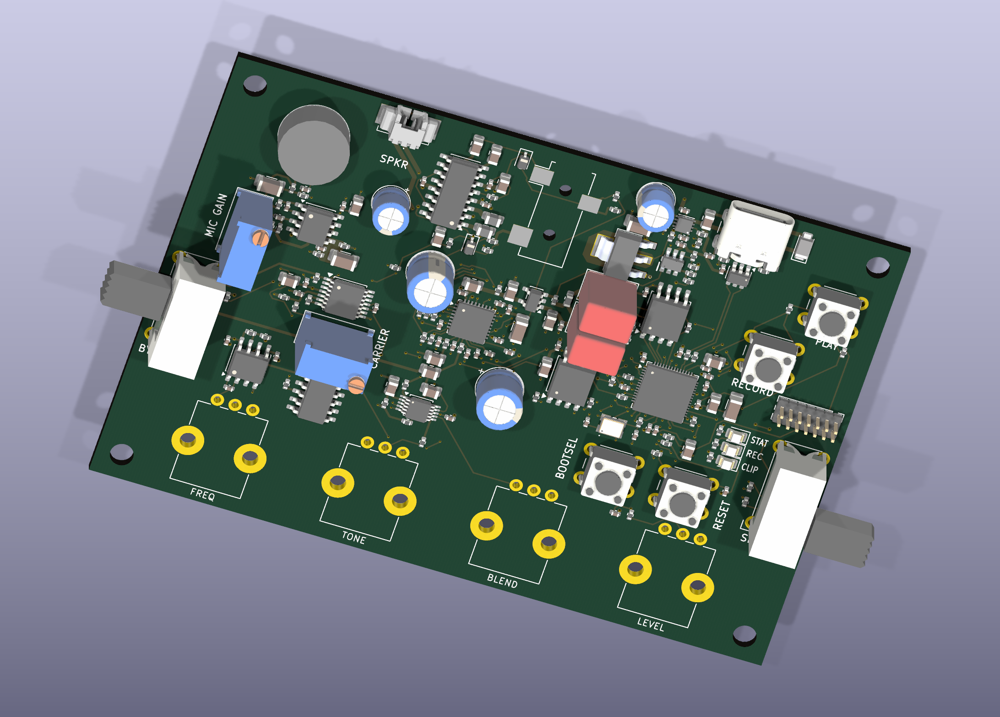

# Voice Modulator screenshots

[Top view](3d/assembled-top.png). The KiCad 3D library lacks matching bodies for J3 and the four bottom potentiometers. Their pads are visible in both views and their placements are included in the assembly files.

## Schematic sheets

- [Overview](schematics/01-overview.png)
- [Power Usb](schematics/02-power-usb.png)
- [Mcu Storage](schematics/03-mcu-storage.png)
- [Microphone](schematics/04-microphone.png)
- [Modulation](schematics/05-modulation.png)
- [Codec](schematics/06-codec.png)
- [Speaker Controls](schematics/07-speaker-controls.png)

The overview image uses a wider print page so the embedded block diagram is fully visible.
